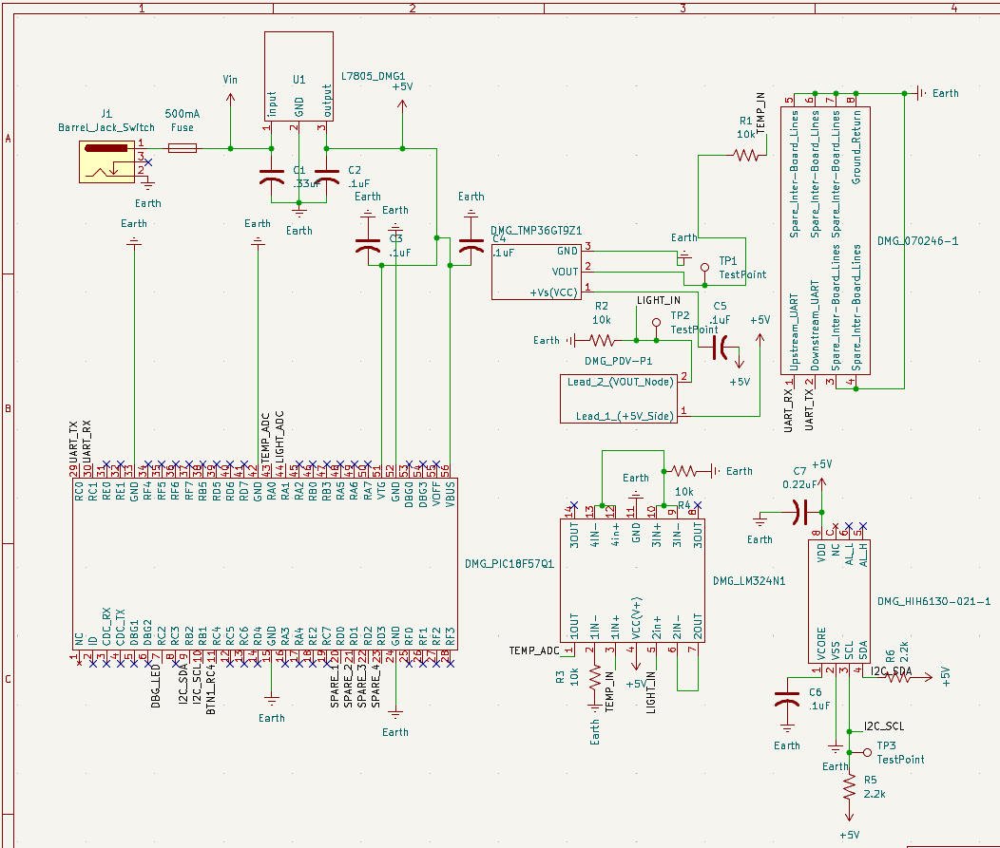

## Overview

This schematic is designed to support the humidity sensor, heat sensors, light sensors, op-amp, and 8-pin connector.

{ width="350" }

**Figure 1:** Example schematic.

## Resources

The schematic as a PDF download is available [here](SUBSYSTEM.pdf), and the zip folder of the project is [here](SUBSIS.zip).
